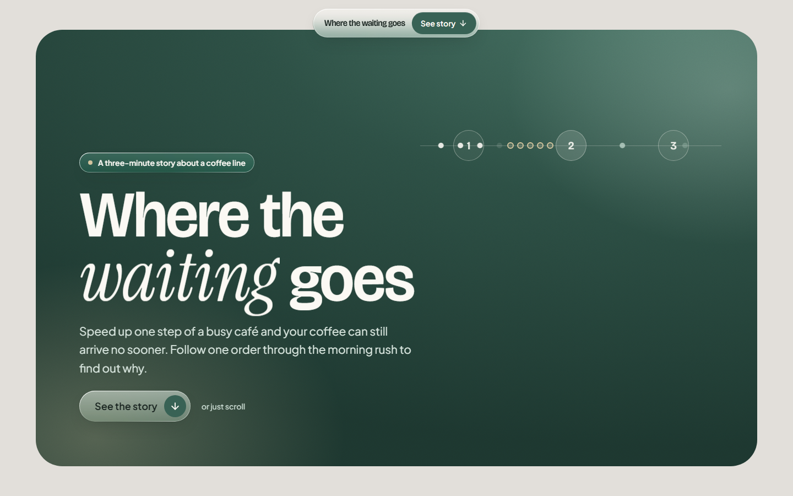
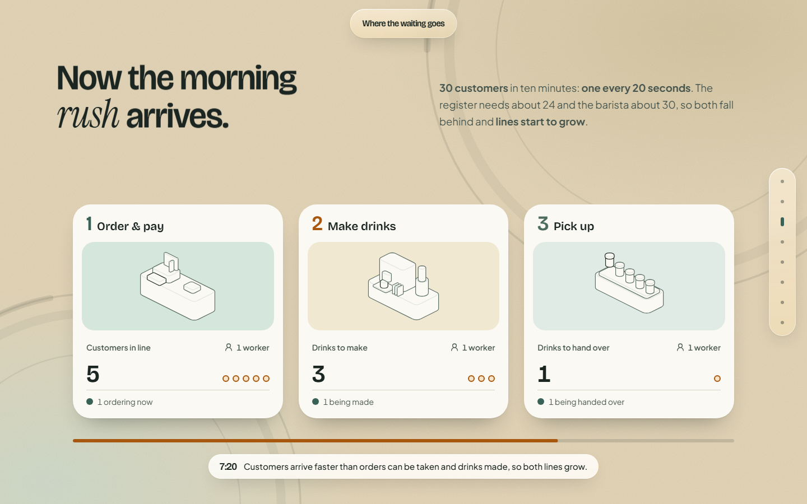
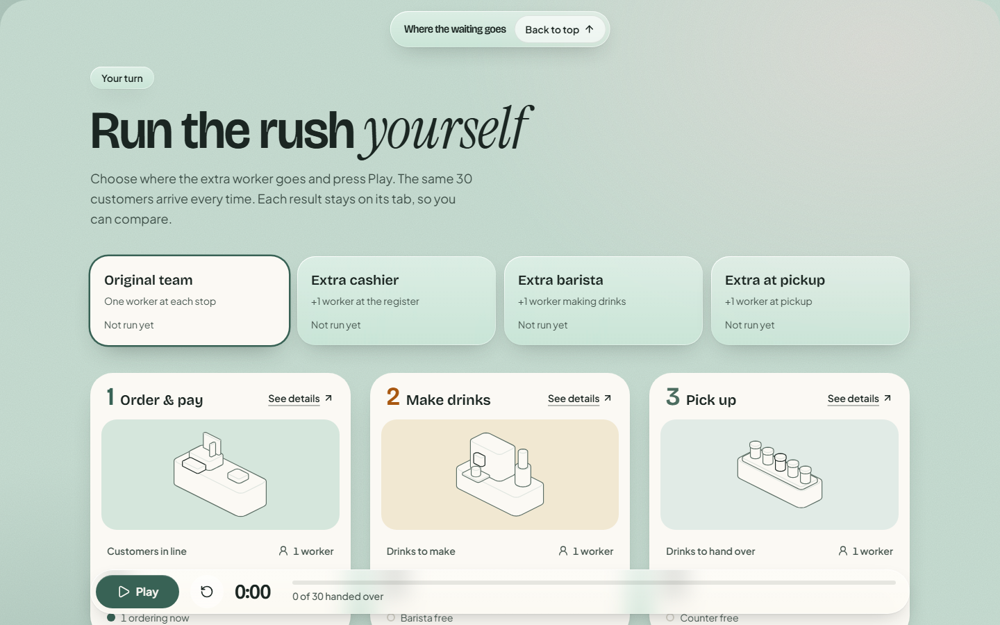

# Where the waiting goes

**If ordering gets faster, why doesn't your coffee?**

A short scroll story about a morning rush in a coffee shop, followed by an experiment you can run yourself. It shows, with one simple simulation, why speeding up the wrong step of a process only moves the line somewhere else, and why helping the slowest step (the bottleneck) is what makes the whole thing faster.

**Live:** https://where-the-waiting-goes.vercel.app



## What's on the page

1. **The story.** Follow one order through the café's three stops: order and pay, make drinks, pick up. Then 30 customers arrive in ten minutes, and the lines start to grow. Adding a second cashier makes ordering faster, but the line just moves to the drinks counter. *We didn't remove the wait. We moved it.*
2. **Your turn.** Put one extra worker at the register, with the barista or at pickup, press Play and compare the results. Every setup gives a different result, and the extra barista helps most.





## How it's built

- **React 19 + TypeScript + Vite**, styled with **Tailwind CSS v4** and Radix/shadcn primitives.
- **GSAP** (ScrollTrigger) for all motion: the hero zoom, the pinned story, and gentle snapping to each chapter. Scrolling stays native.
- **Isometric line illustrations** in the style of Hairline, drawn in code and responsive to the pointer.
- **A deterministic simulation** in plain TypeScript (`src/simulation/`). Every number on the page comes from it; nothing is hardcoded. It is a simplified model, not a forecast for a real café.
- **Static site**, no backend. Deployed on Vercel; every push to `main` goes live.

On wide screens the story is pinned and scrubbed by scroll. On phones, tablets and with reduced motion turned on, it becomes a plain sequence of sections with the same content.

### The model in one paragraph

30 customers arrive one every 20 seconds. Each visits order and pay, make drinks, then pick up, waiting in a first-come, first-served line at each. Service times vary from customer to customer in a fixed repeating pattern (orders average 24 s, drinks 30 s, pickup 20 s), so drinks are the bottleneck. Full assumptions and the verified results that the tests check are in [docs/simulation.md](docs/simulation.md).

| Setup | Handed over by 10:00 | Average door to cup |
| --- | --- | --- |
| Original team | 17 of 30 | 3:51 |
| Extra cashier | 18 of 30 | 3:32 |
| Extra barista | 21 of 30 | 2:21 |
| Extra at pickup | 17 of 30 | 3:42 |

## Run it locally

Needs Node 24.

```sh
npm ci
npm run dev        # dev server at http://localhost:5173
```

To check the production build the way it ships:

```sh
npm run serve      # builds, then serves on http://localhost:4173
```

## Checks

```sh
npm run typecheck && npm run lint && npm test   # types, lint, unit tests (Vitest)
npm run test:e2e                                # Playwright, desktop and phone
```

There are also exploratory QA scripts (layout overlap sweep, accessibility with axe, contrast, keyboard, performance) run against `npm run serve`; see [tests/qa/README.md](tests/qa/README.md).

## Project layout

```
src/
  simulation/   the model: config, engine, presets, metrics (pure TypeScript, unit tested)
  story/        hero, pinned and plain story layouts, chapter frames, scroll timeline
  experiment/   the "Your turn" workspace, results card, dialogs
  components/   station tiles and shared UI
  illustrations/ isometric line figures
  app/          page shell and floating nav
tests/
  e2e/          Playwright specs
  qa/           exploratory QA scripts
docs/           simulation contract, progress log, design notes
```

## Further reading

- [plan.md](plan.md): the original brief
- [PRODUCT.md](PRODUCT.md) and [DESIGN.md](DESIGN.md): product and visual decisions
- [docs/progress.md](docs/progress.md): what's done, what's verified, what's still open
